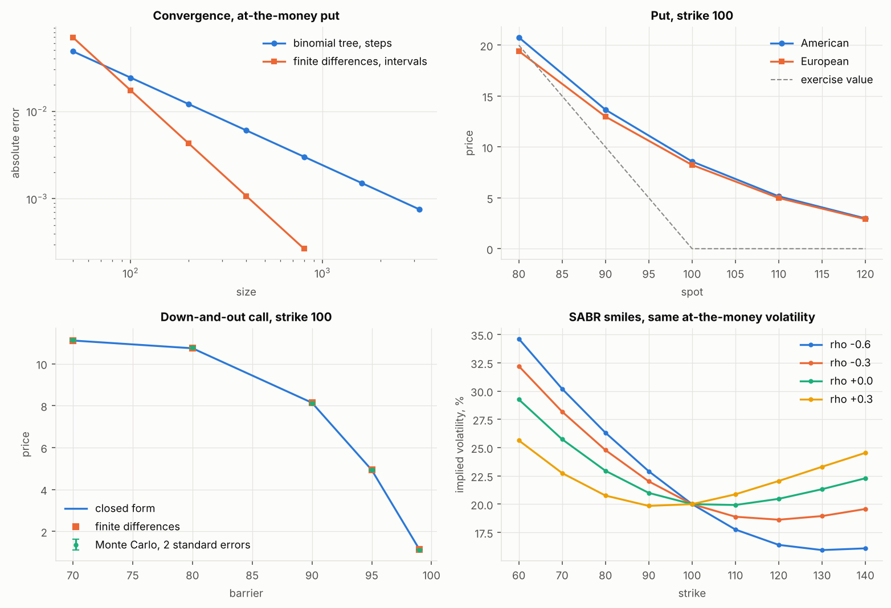

# PriceKit

A derivatives pricing library in Rust with no dependencies: closed forms, a binomial tree, a finite-difference solver and Monte Carlo, built so that every number is checked by at least one other method.

The same contract priced several ways is the cheapest test there is. A closed form checks the grid, the grid checks the tree on American exercise where no closed form exists, and both pin down Monte Carlo to within its own error bars.

## What is inside

| Layer | Modules | Content |
|---|---|---|
| `math` | `normal`, `roots`, `tridiag`, `rng`, `stats`, `interp` | normal distribution to machine precision, bracketed root finders, Thomas solver, xoshiro generator, running moments |
| `products` | `vanilla`, `digital`, `barrier`, `asian`, `lookback` | closed forms with dividend yield, analytic sensitivities |
| `engines` | `binomial`, `pde`, `montecarlo`, `greeks` | European and American trees, Crank-Nicolson grid with smoothing start and barrier alignment, antithetic paths with bridge corrections and a control variate, bump-and-reprice |
| `vol` | `implied`, `sabr` | implied volatility on normalised prices, SABR formula and smile calibration |

Python (`src/pricekit`) only drives the binary, compares against SciPy and writes the report.

## Results

Spot 100, rate 5%, dividend yield 2%, volatility 25%, one year. Full tables in `reports/report.md`.

| Test | Result |
|---|---|
| Closed form against an independent SciPy implementation | agree to 2e-14 |
| Binomial tree, 2,000 steps | error up to 1.2e-3, first order |
| Finite differences, two grids extrapolated | error up to 6e-6, second order (fitted 2.00) |
| Monte Carlo, 800,000 paths | all 6 prices within 0.4 standard errors |
| American put, grid against tree | agree to 1.5e-4 over five spots |
| Down-and-out call, grid against closed form | error up to 2e-6, including a barrier 1% below spot |
| Down-and-out call, Monte Carlo with 10 time steps | unbiased, largest deviation 1.3 standard errors |
| Asian call, geometric control variate | standard error 30 times smaller |
| Lookback call, 4 time steps | unbiased (0.4 standard errors) |
| Implied volatility round trip | relative error below 4e-13, down to a price of 2e-145 |



## Three details that do the work

1. **Grid alignment.** The finite-difference grid puts a node on the strike and, for a knock-out, a node on the barrier. With the two half steps of implicit Euler at the start this keeps the error a clean multiple of the squared spacing, so one extrapolation between two grids removes it.
2. **Bridge sampling.** Between two simulated dates the minimum of the path has a known distribution. The lookback draws that minimum exactly, the barrier multiplies by the survival probability. Both are then unbiased with any number of time steps, 4 is as good as 64.
3. **Normalised implied volatility.** The solver works on the out-of-the-money price divided by the forward, in log space, with a bracketed Halley iteration. It never subtracts two close numbers, which is why a price of 1e-145 still inverts.

## Reading the numbers

- Everything here is Black-Scholes with constant parameters, or SABR through the asymptotic formula. The library tests numerics, it says nothing about which model fits a market.
- "Unbiased" means no deviation was detected at the stated number of paths. A bias below about 0.03 on the barrier price would not be seen.
- The tree converges at first order and oscillates with the strike position, the extrapolated tree figure is a convenience and not a guarantee. The American check is two methods agreeing, not an exact reference.
- American exercise is implemented for puts on the grid, and for both kinds on the tree.
- The SABR formula is the standard expansion, it is known to give negative densities at very low strikes and long maturities. No correction is applied.
- The barrier formulas require the barrier at or below the strike.

## Run it

```
pip install -e ".[dev]"
make build      # cargo build --release
make test       # cargo test, then pytest
make run        # writes reports/
```

From Rust:

```rust
use pricekit::engines::pde::{solve_extrapolated, Spec};
use pricekit::engines::Exercise;
use pricekit::{Market, OptionKind};

let market = Market::new(100.0, 0.05, 0.0, 0.2);
let put = Spec { kind: OptionKind::Put, exercise: Exercise::American, strike: 100.0, maturity: 1.0, lower_barrier: None };
let price = solve_extrapolated(&market, &put, 400);
```

Examples: `cargo run --release --manifest-path engine/Cargo.toml --example american_put` (also `price_vanilla`, `barrier_table`, `smile`).
From the shell: `python scripts/price.py american spot=95 strike=100 vol=0.25 rate=0.05 maturity=0.5`.

## Layout

```
engine/src/        the library (math, products, engines, vol) and the command line binary
engine/tests/      integration tests, one file per subject
engine/examples/   four short programs
src/pricekit/      Python driver, report and figure
configs/           the cases of the report
docs/              methods and formulas
reports/           report, validation table, metrics, figure
```

## Author

Amir Masominia. PhD in physics (Université Paris-Saclay); postdoctoral researcher working on machine-learning surrogate models, numerical simulation and automated measurement pipelines.

MIT licence.
